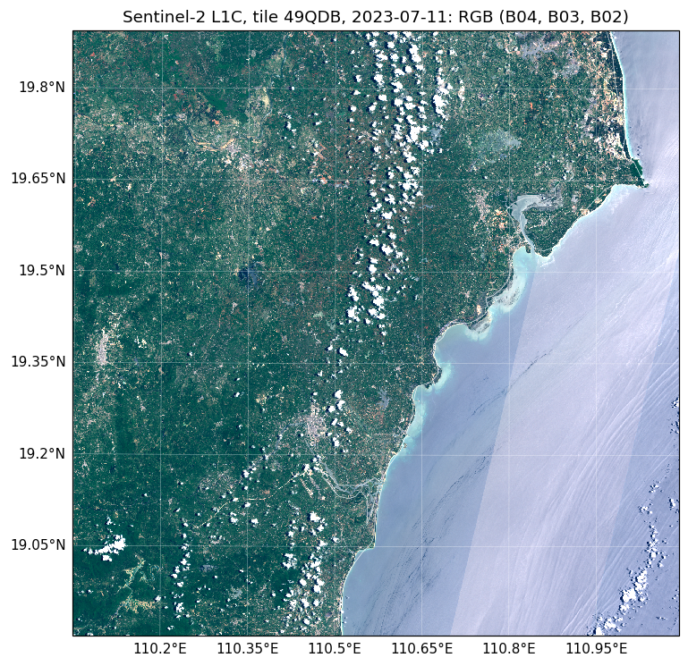
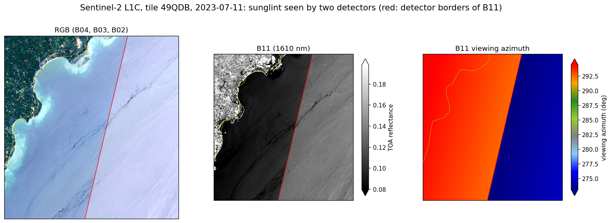
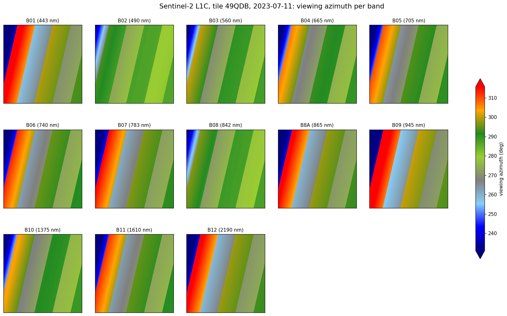
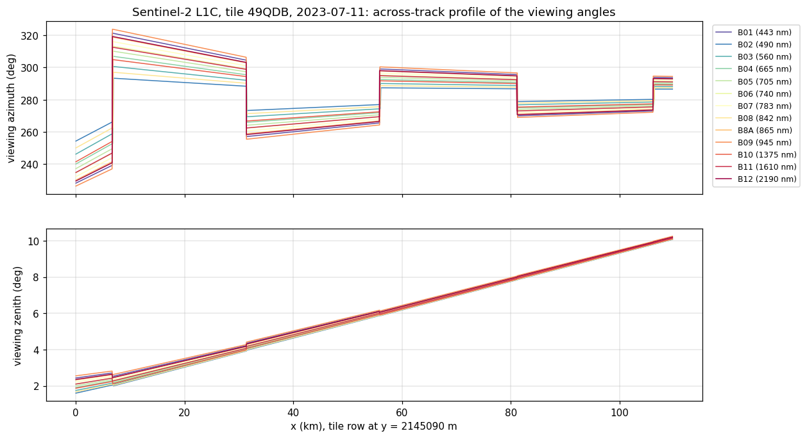
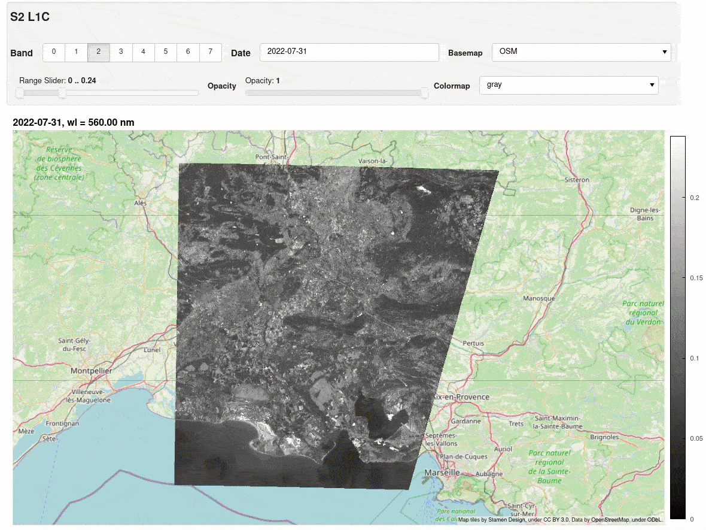
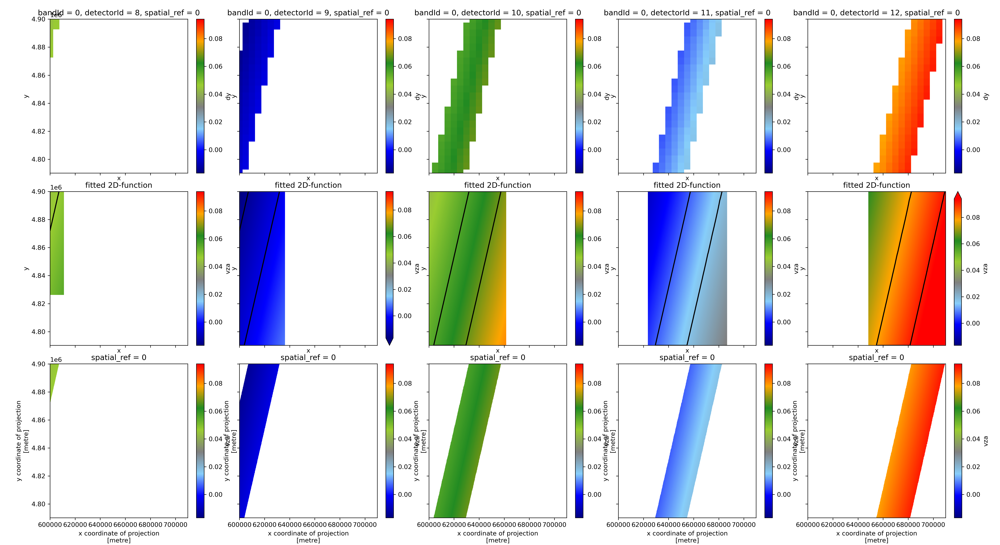
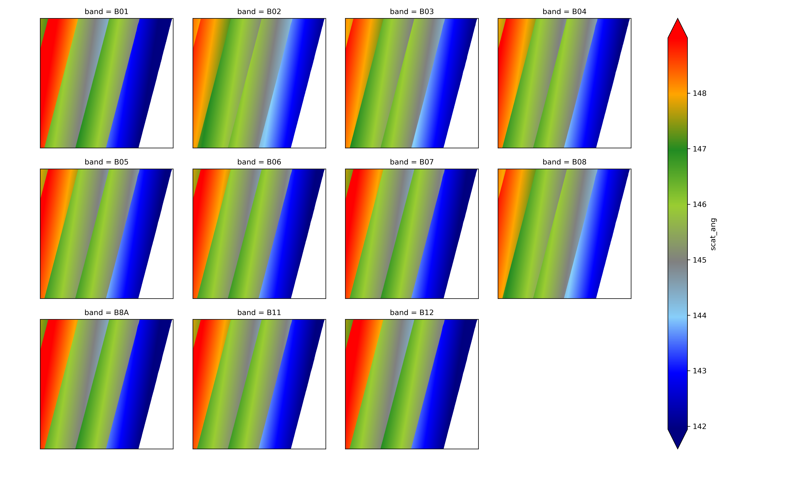
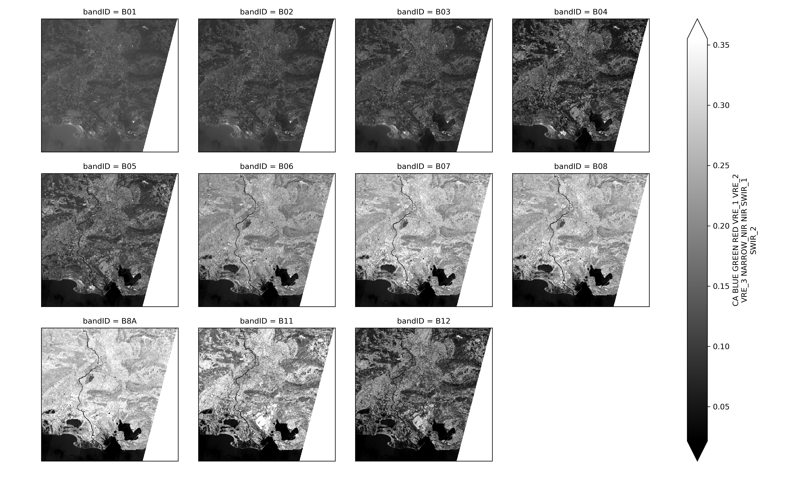
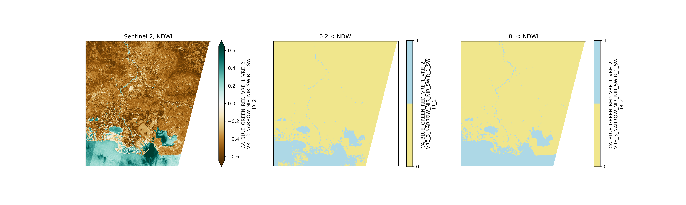

# GRSdriver package
## Driver dedicated to load and prepare data for the GRS processor

[](https://pypi.org/project/GRSdriver/)
[](https://grsdriver.readthedocs.io)

GRSdriver loads a Level-1 satellite image into a single `xarray.Dataset` ready for the
[GRS](https://github.com/CNES/GRSprocessor) atmospheric and sunglint correction:

- Sentinel-2 L1C (`.SAFE`): top-of-atmosphere reflectance of the selected bands on a common grid,
  with accurate viewing angles computed **per band and per detector** from the granule metadata
- Landsat 8 and 9 Collection-2 L1: reflectance, brightness temperature of the thermal bands,
  sun/viewing angles and L1 quality flags
- spectral response functions and central wavelengths of each band
- spatial subsetting, lazy (dask) loading and low memory options for full tiles
- visualization tools

Full documentation: https://grsdriver.readthedocs.io

## Installation

```commandline
pip install GRSdriver
```

GRSdriver needs GDAL. If you have no GDAL installation yet, use a conda environment and install
GDAL before GRSdriver:
```commandline
conda install -c conda-forge gdal
```

### Installation from the repository (to use the notebooks and visualization tools)
```commandline
git clone https://github.com/Tristanovsk/GRSdriver.git
cd GRSdriver
conda env create -f environment.yml
conda activate grs
pip install -e .
```

For the interactive visualization tools and the notebooks:
```commandline
conda install -c conda-forge jupyterlab holoviews panel datashader cartopy
```

## Quick start

```python
from GRSdriver import Sentinel2Driver, LandsatDriver

# Sentinel-2: 20 m bands, viewing angles computed on a 60 m grid
l1c = Sentinel2Driver('S2B_MSIL1C_..._.SAFE', resolution=20)
l1c.load_product()
prod = l1c.prod          # bands, vza, raa, sza, SRF, wl_true + metadata

# Landsat 8/9
l1 = LandsatDriver('LC09_L1TP_..._02_T1', resolution=30)
l1.load_product()
```

For a full Sentinel-2 tile at 10 m, `Sentinel2Driver(..., lazy_geom=True)` keeps the per-band
viewing angles lazy and saves several GB of memory. Set `GRSDRIVER_USE_DASK=1` before importing
GRSdriver to get a fully lazy (dask-backed) product.

### Command line

`grs_driver` writes an RGB quicklook (PNG) of a Sentinel-2 or Landsat product:
```commandline
grs_driver S2B_MSIL1C_..._.SAFE --odir ./quicklooks --resolution 60
```

## Tutorials

The notebooks are in [`notebook/`](notebook) and rendered with their outputs in the
[documentation](https://grsdriver.readthedocs.io):

| Notebook | Content |
|---|---|
| `GRSdriver_basics` | load a Sentinel-2 L1C image, geometry, RGB, NDWI water mask |
| `GRSdriver_subsetting` | subset a time series of images and build a datacube |
| `GRSdriver_landsat9_TIR` | Landsat 9 with its thermal bands |
| `GRSdriver_landsat9_L1_CAMS` | Landsat 9 with CAMS atmospheric data |
| `sentinel2_download` | download Sentinel-2 L1C images |

The paths to the images are those of the author's machine: set them to your own data. See
[Updating the tutorials](https://grsdriver.readthedocs.io/en/latest/contributing.html) to rerun
them for the documentation.

## Sentinel-2 viewing geometry

The MSI swath is covered by 12 staggered detectors: odd and even detectors look in opposite
directions, and the bands of a detector are shifted in the focal plane. Each band therefore has
its own viewing angles, with jumps at the detector borders. GRSdriver computes them per band and
per detector from the L1C metadata (see
[Methods](https://grsdriver.readthedocs.io/en/latest/methods.html)).



Over water, sunglint is so directional that its reflectance changes abruptly at the detector
borders: here +23 % in B11 (1610 nm) between detectors 10 and 11 (right: viewing azimuth). These
stripes are a property of the target, not an artifact, and their size depends on the sea
roughness, i.e. on the wind speed
([Fougnie et al., 2016](https://doi.org/10.1117/12.2237597);
[Harmel et al., 2018](https://doi.org/10.1016/j.rse.2017.10.022)):



Viewing azimuth of each band computed by GRSdriver:





## Example



## 2D-fitting method for angle computation





## Example of water masking



## Changes

See [CHANGELOG.md](CHANGELOG.md).
