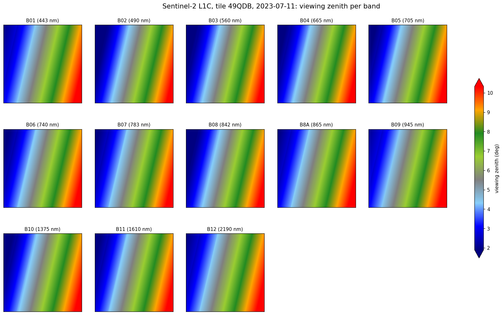
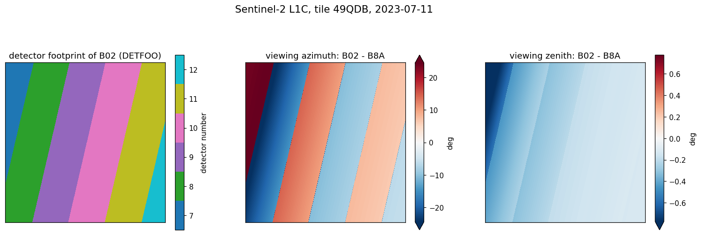

Methods
=======

This page describes how the drivers compute the variables of the loaded product
(``prod``): top-of-atmosphere reflectance, central wavelengths and sun/viewing geometry.
Notation:

- :math:`(x, y)`: pixel coordinates in the projected CRS of the product (m);
- :math:`\lambda`: wavelength (nm), :math:`b` a spectral band, :math:`d` a detector;
- :math:`\theta_s, \phi_s`: solar zenith and azimuth angles;
- :math:`\theta_v, \phi_v`: viewing zenith and azimuth angles.

All the angles are in degrees.

Top-of-atmosphere reflectance
-----------------------------

The bands are read with rasterio/GDAL on the output grid: the digital counts are averaged
when the output pixel is coarser than the native one (e.g. 10 m bands at 20 m), bilinearly
interpolated when it is finer (e.g. 60 m bands at 20 m), pixels with :math:`DN = 0` being ignored.
They are then converted into top-of-atmosphere (TOA) reflectance; negative values are set to 0.

Sentinel-2 L1C
~~~~~~~~~~~~~~

The L1C digital numbers :math:`DN_b` are converted with the quantification value
(:math:`Q = 10000`) and, since processing baseline 04.00, the radiometric offset
:math:`O_b` (:math:`-1000`) of the product metadata:

.. math::

    \rho_b(x, y) = \frac{DN_b(x, y) + O_b}{Q}

Landsat 8/9 Collection 2 Level-1
~~~~~~~~~~~~~~~~~~~~~~~~~~~~~~~~

The quantized values :math:`Q_{cal}` are rescaled with the coefficients of the metadata
(``REFLECTANCE_MULT_BAND_b``, ``REFLECTANCE_ADD_BAND_b``) into a reflectance that is not yet
corrected for the solar zenith angle; the driver applies this correction to the
vis-NIR-SWIR bands (:math:`\lambda \leq 3000` nm):

.. math::

    \rho_b(x, y) = \frac{M_{\rho, b}\, Q_{cal, b}(x, y) + A_{\rho, b}}{\cos \theta_s(x, y)}

Fill pixels (``QA_PIXEL`` = 1 or :math:`Q_{cal}` = 0) are set to NaN and negative values to 0.
When the output pixel size differs from the native one, :math:`Q_{cal}` is averaged (coarser
output, e.g. PAN at 30 m) or bilinearly interpolated (finer output) by GDAL before the
rescaling; ``QA_PIXEL`` is resampled with nearest neighbour.

The thermal bands (TIR_1, TIR_2) are given as brightness temperature (K), from the
TOA radiance :math:`L_b` and the thermal constants :math:`K_{1,b}, K_{2,b}` of the metadata:

.. math::

    T_b(x, y) = \frac{K_{2,b}}{\ln\left(\dfrac{K_{1,b}}{L_b(x, y)} + 1\right)}

Central wavelengths
-------------------

``SRF`` (wl, wl_hr) holds the spectral response function :math:`S_b(\lambda)` of each band
on a 1 nm grid (Sentinel-2: from the L1C metadata; Landsat: files shipped with GRSdriver).
The central wavelength ``wl_true`` is the SRF-weighted mean wavelength:

.. math::

    \lambda_b = \frac{\displaystyle\int \lambda\, S_b(\lambda)\, \mathrm{d}\lambda}
                     {\displaystyle\int S_b(\lambda)\, \mathrm{d}\lambda}

computed with the trapezoidal rule over the defined values of :math:`S_b`. The ``wl``
coordinate keeps the nominal wavelength of each band.

Sentinel-2 geometry
-------------------

The granule metadata (``MTD_TL.xml``) gives the angles on a coarse grid of
:math:`23 \times 23` nodes (5 km spacing): one grid for the sun angles, and one grid per band
and per detector for the viewing angles, each detector covering only a strip of the tile.
The angles are computed on the ``resolution_angle`` grid (10, 20 or 60 m), then resampled
onto the grid of the bands (see `Resampling onto the band grid`_).

MSI focal plane and detectors
~~~~~~~~~~~~~~~~~~~~~~~~~~~~~

The MultiSpectral Instrument (MSI) is a push-broom imager. Its 290 km swath is covered by
**12 detectors** mounted in a staggered configuration on each focal plane (one for the VNIR
bands, one for the SWIR bands) [ESA-MSI]_ [Binet2022]_:

- odd and even detectors look in opposite directions along track (forward and backward), so
  they do not see the ground with the same viewing angles. The **viewing azimuth jumps** at the
  border between two detectors (about 20° in the tile below, more near nadir);
- within a detector, the spectral bands are lines shifted along track in the focal plane, and
  the order of the bands is inverted between odd and even detectors [Binet2022]_. Each band
  therefore has **its own viewing angles**, and a given ground point is seen by the bands at
  slightly different times (from about 20 ms up to 2.6 s, between B02 and B09), which causes the
  "rainbow" effect on moving or elevated objects (planes, clouds) [ESA-MSI]_ [Binet2022]_;
- the viewing zenith angle stays below about 12° over the swath and varies little from band to
  band [Harmel2018]_.

The L1C product describes this geometry with the viewing angle grids per band and per
detector (``Viewing_Incidence_Angles_Grids`` of ``MTD_TL.xml``) and the detector footprint
masks ``MSK_DETFOO_Bxx`` [ESA-PSD]_, both used by GRSdriver.

The discontinuities matter over water. Sunglint, the reflection of the sun on the sea surface,
is spread into a cone a few degrees wide whose width increases with the surface roughness, i.e.
with the wind speed [CoxMunk1954]_. It is therefore a very directional signal: a change of a
fraction of a degree in the viewing direction can change the glint reflectance a lot. The
stripes seen over the sea in sunglint since the first MSI image (June 2015), and in Landsat-8/OLI
images whose 185 km swath is covered by 14 staggered modules, are not instrumental artifacts but
this directional effect of the target [Fougnie2016]_. This is why GRS needs per-band and
per-detector viewing angles to model and remove the sunglint [Harmel2018]_.

At the border between an even (:math:`e`) and an odd (:math:`o`) detector, the same sea target is
seen under two geometries that differ by a few tenths of a degree. The atmospheric and marine
terms are then nearly the same for both views, and only the glint reflectance :math:`\rho_g`
changes, so that the difference of TOA reflectance is the difference of glint attenuated by the
gaseous and atmospheric transmissions :math:`T_g` and :math:`T` [Fougnie2016]_:

.. math::

    \Delta\rho = \rho_{TOA}^{e} - \rho_{TOA}^{o}
    \simeq T_g\, T \left[\rho_g(\theta_s^e, \theta_v^e, \phi^e) - \rho_g(\theta_s^o, \theta_v^o, \phi^o)\right]

When the glint dominates (red, NIR and SWIR bands), the normalized difference no longer depends
on the aerosol and marine signals:

.. math::

    \frac{\Delta\rho}{\rho} \simeq 2\,
    \frac{\rho_g^{e} - \rho_g^{o}}{\rho_g^{e} + \rho_g^{o}}

and, with the Cox and Munk model, depends mainly on the wind speed: the flatter the sea, the
larger the gap. For the first MSI image, the gap between detectors 10 and 11 goes from about 10 %
for a wind speed of 2 m/s to 2 % for 10 m/s, and is about twice as large between detectors 11
and 12, closer to the specular direction. Each detector border in sunglint thus acts as a local
bidirectional measurement from which the surface wind speed can be estimated
[Fougnie2016]_. These estimates all rely on the exact viewing angles of each detector and band,
as provided by GRSdriver.

The figures below show such a gap on a recent image.

.. figure:: _static/s2_rgb.png
   :width: 70%
   :alt: RGB image of a Sentinel-2 tile with sunglint

   RGB image (B04, B03, B02) of tile 49QDB (Hainan, China, 2023-07-11) loaded with GRSdriver.
   Over the sea, the sunglint shows steps of brightness along the detector borders.

.. figure:: _static/s2_sunglint_detectors.png
   :width: 100%
   :alt: sunglint discontinuity at a detector border

   Zoom on the sea: the TOA reflectance of B11 (1610 nm), mostly sunglint, jumps from 0.101 to
   0.127 (median of the 3 pixels on each side) at the border between detectors 10 and 11 (red
   line, from ``MSK_DETFOO``), where the viewing azimuth changes by about 20°. The normalized gap
   is 23 % in B11, B8A and B12, and 14 % in B04, where the aerosol and marine signals add to the
   glint. It is larger than the 2-10 % computed by [Fougnie2016]_ for the same detector border
   of the first MSI image, which points to a smoother sea or a geometry closer to the specular
   direction.

Sun angles
~~~~~~~~~~

The sun angles vary smoothly over the tile: :math:`\theta_s` and :math:`\phi_s` are
bilinearly interpolated from the four surrounding nodes :math:`(x_i, y_j)`:

.. math::

    \theta_s(x, y) = \sum_{i, j \in \{0, 1\}} w_i(x)\, w_j(y)\, \theta_s(x_i, y_j)

.. math::

    w_1(x) = \frac{x - x_0}{x_1 - x_0}, \qquad w_0(x) = 1 - w_1(x)

and similarly for :math:`w_j(y)` and :math:`\phi_s`.

Viewing angles
~~~~~~~~~~~~~~

The viewing angles are discontinuous at the borders between detectors, so that a direct
interpolation of the 5 km grids would be wrong in the overlap of two detectors. Instead,
for each band :math:`b` and each detector :math:`d`, the angle :math:`\alpha`
(:math:`\theta_v` or :math:`\phi_v`) is modelled as a plane:

.. math::

    \alpha_{b,d}(x, y) = \beta_{0}\, x + \beta_{1}\, y + \beta_{2}

The coefficients :math:`\boldsymbol\beta_{b,d} = (\beta_0, \beta_1, \beta_2)` are fitted on the
:math:`n` valid nodes :math:`(x_k, y_k, \alpha_k)` of the detector grid (NaN nodes removed) by
orthogonal distance regression (``scipy.odr``), which minimizes the sum of squared orthogonal
distances between the nodes and the plane, i.e. accounts for errors on the coordinates
:math:`\mathbf{p}_k = (x_k, y_k)` as well as on the angles:

.. math::

    \hat{\boldsymbol\beta}_{b,d} = \arg\min_{\boldsymbol\beta,\, \boldsymbol\delta}
    \sum_{k=1}^{n} \Big[ \big(\alpha_k - \alpha(\mathbf{p}_k + \boldsymbol\delta_k;
    \boldsymbol\beta)\big)^2 + \lVert \boldsymbol\delta_k \rVert^2 \Big]

starting from :math:`\boldsymbol\beta = (0, 0, \bar\alpha)`.

The detector footprint mask (``DETFOO``) of the L1C product gives the detector
:math:`D_b(x, y)` that sees each pixel. The angle of a pixel is the plane of that detector:

.. math::

    \alpha_b(x, y) = \alpha_{b, D_b(x, y)}(x, y)

Pixels seen by no detector (outside the swath) are set to NaN. This evaluation is compiled
with numba and done in float32.

The result, for the 13 bands of tile 49QDB:

.. figure:: _static/s2_view_azimuth_bands.png
   :width: 100%
   :alt: viewing azimuth of each Sentinel-2 band

   Viewing azimuth of each band (``(raa + saa) % 360``): one strip per detector, with jumps at
   the detector borders. The values within each strip differ from band to band.

   Viewing zenith angle (``vza``) of each band: it increases across track from nadir (left) to
   the edge of the swath, with small steps at the detector borders.

.. figure:: _static/s2_detector_profile.png
   :width: 90%
   :alt: across-track profile of the viewing angles

   Across-track profile of the viewing angles (one row of the tile): sawtooth of the viewing
   azimuth between odd and even detectors, and spread of the values between bands within a
   detector. The azimuth varies most near nadir, where a small change in viewing direction
   gives a large change in azimuth.

   Detector footprint of B02 (``MSK_DETFOO``) and difference of the viewing angles between B02
   and B8A: the sign of the azimuth difference alternates between odd and even detectors, as
   the order of the bands is inverted in the focal plane.

The figures are made with ``docs/figures/make_geometry_figures.py``.

Relative azimuth
~~~~~~~~~~~~~~~~

.. math::

    \phi_b(x, y) = \big(\phi_{v,b}(x, y) - \phi_s(x, y)\big) \bmod 360

Variables: ``sza`` = :math:`\theta_s` (y, x); ``vza`` = :math:`\theta_{v,b}` and
``raa`` = :math:`\phi_b` (wl, y, x).

Landsat geometry
----------------

The angles are read from the angle GeoTIFFs of the product (``*_SZA.TIF``, ``*_SAA.TIF``,
``*_VZA.TIF``, ``*_VAA.TIF``), stored as integers :math:`I` in hundredths of degree
(0 = no data):

.. math::

    \alpha(x, y) = 0.01\, I(x, y)

The OLI swath is also covered by staggered detector modules (14) that view slightly forward or
backward, with sunglint stripes at their borders [Fougnie2016]_, but the angle files of the
Collection-2 products give one geometry per pixel for all the bands.
They are not band specific: ``sza``, ``vza`` and ``raa`` are (y, x) arrays, with the
relative azimuth

.. math::

    \phi(x, y) = \phi_s(x, y) - \phi_v(x, y)

(note the convention, opposite to the one of the Sentinel-2 driver, and without modulo).
When the bands are loaded at another resolution or on a subset, the angles are bilinearly
interpolated onto the grid of the bands, and the L1 bitmask ``flags_l1`` is resampled by
nearest neighbour.

Resampling onto the band grid
-----------------------------

For Sentinel-2, the angles computed at ``resolution_angle`` are put on the band grid
(``resolution``, possibly a subset) by nearest neighbour. For a band pixel center
:math:`(x, y)`, the source pixel is

.. math::

    i(x) = \arg\min_{i} |x - x_i|, \qquad j(y) = \arg\min_{j} |y - y_j|

where :math:`x_i, y_j` are the coordinates of the angle grid; the lookup is a plain
array indexing :math:`\alpha(x, y) = A[j(y), i(x)]`, separable in :math:`x` and :math:`y`.

Scattering angle
----------------

Both drivers provide ``scat_angle`` to compute the scattering angle :math:`\Theta` from
the sun and viewing angles, with the relative azimuth :math:`\phi` defined such that
:math:`\phi = 180^\circ` when the sun and the sensor are in opposition (backscattering
geometry when :math:`\theta_v = \theta_s`):

.. math::

    \cos \Theta = -\cos\theta_s \cos\theta_v - \sin\theta_s \sin\theta_v \cos\phi

Memory footprint
----------------

Each float32 variable of dimensions (wl, y, x) needs

.. math::

    M = 4\, N_\lambda\, N_y\, N_x \ \text{bytes}

For a full Sentinel-2 tile (:math:`N_\lambda = 13` bands; :math:`N_y = N_x = 5490` at
20 m, :math:`10980` at 10 m), ``bands``, ``vza`` and ``raa`` take 1.57 GB each at 20 m and
6.3 GB each at 10 m.

Two options reduce the memory used by the Sentinel-2 driver:

- the bands are loaded one by one into a preallocated array, so that the loading needs
  about the size of the final ``bands`` array plus the temporaries of one band;
- with ``lazy_geom=True``, ``vza`` and ``raa`` are dask arrays: each block is looked up in the
  ``resolution_angle`` grid of :math:`N_y' \times N_x'` pixels (:math:`4 N_\lambda N_y' N_x'` bytes
  per variable, e.g. 0.17 GB at 60 m)
  only when it is computed, so that the :math:`2 \times 4 N_\lambda N_y N_x` bytes of the
  full-resolution angles are never allocated (3.1 GB at 20 m, 12.5 GB at 10 m).

.. code-block:: python

    from GRSdriver import Sentinel2Driver

    l1c = Sentinel2Driver('S2A_MSIL1C_..._.SAFE',
                          resolution=20, lazy_geom=True)
    l1c.load_product()
    # dask array, computed by blocks of geom_chunks x geom_chunks pixels
    l1c.prod.vza

Measured peak memory for a full tile (13 bands, 20 m): 7.0 GB with the full-resolution
angles, 3.7 GB with ``lazy_geom=True``.

References
----------

.. [Harmel2018] Harmel, T., Chami, M., Tormos, T., Reynaud, N., Danis, P.-A. (2018). Sunglint
   correction of the Multi-Spectral Instrument (MSI)-SENTINEL-2 imagery over inland and sea
   waters from SWIR bands. *Remote Sensing of Environment*, 204, 308-321.
   https://doi.org/10.1016/j.rse.2017.10.022

.. [Binet2022] Binet, R., Bergsma, E., Poulain, V. (2022). Accurate Sentinel-2 inter-band time
   delays. *ISPRS Annals of the Photogrammetry, Remote Sensing and Spatial Information
   Sciences*, V-1-2022, 57-66. https://doi.org/10.5194/isprs-annals-V-1-2022-57-2022

.. [Fougnie2016] Fougnie, B., Hagolle, O., Lachérade, S. (2016). Surface wind speed estimation over
   open ocean using bidirectional observation by Sentinel-2/MSI and Landsat-8/OLI. *Proc. SPIE*
   9972, Earth Observing Systems XXI, 997211. https://doi.org/10.1117/12.2237597

.. [CoxMunk1954] Cox, C., Munk, W. (1954). Measurement of the roughness of the sea surface from
   photographs of the sun's glitter. *Journal of the Optical Society of America*, 44(11),
   838-850. https://doi.org/10.1364/JOSA.44.000838

.. [ESA-PSD] ESA / CS Group (2026). *Sentinel-2 Products Specification Document*,
   S2-PDGS-CS-DI-PSD, issue 15.2: ``Tile_Angles`` (``Sun_Angles_Grid``,
   ``Viewing_Incidence_Angles_Grids``) of the granule metadata and ``MSK_DETFOO`` masks.

.. [ESA-MSI] ESA, Sentinel-2 MSI technical guide: `MSI instrument
   <https://sentinel.esa.int/web/sentinel/technical-guides/sentinel-2-msi/msi-instrument>`_ and
   `anomalies and product features
   <https://sentinel.esa.int/web/sentinel/technical-guides/sentinel-2-msi/anomalies-and-product-features>`_
   (parallax between odd and even detectors, "rainbow" effect, sunglint discontinuities).
